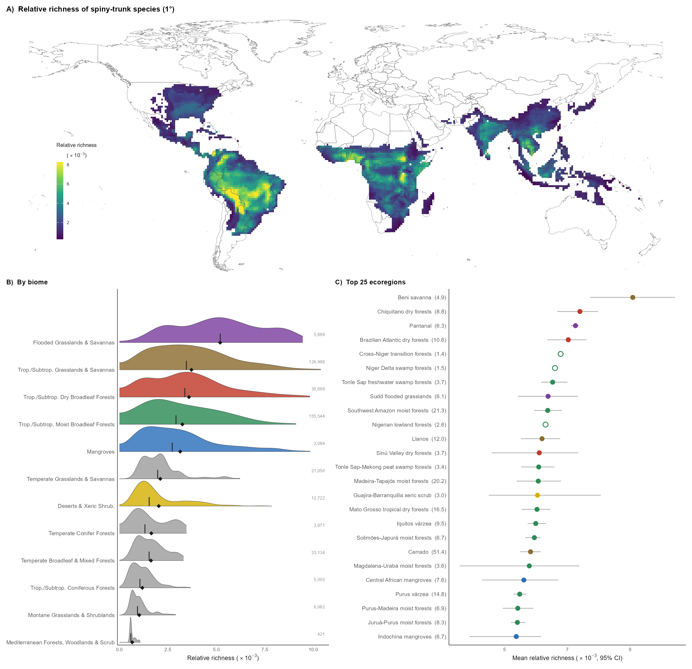
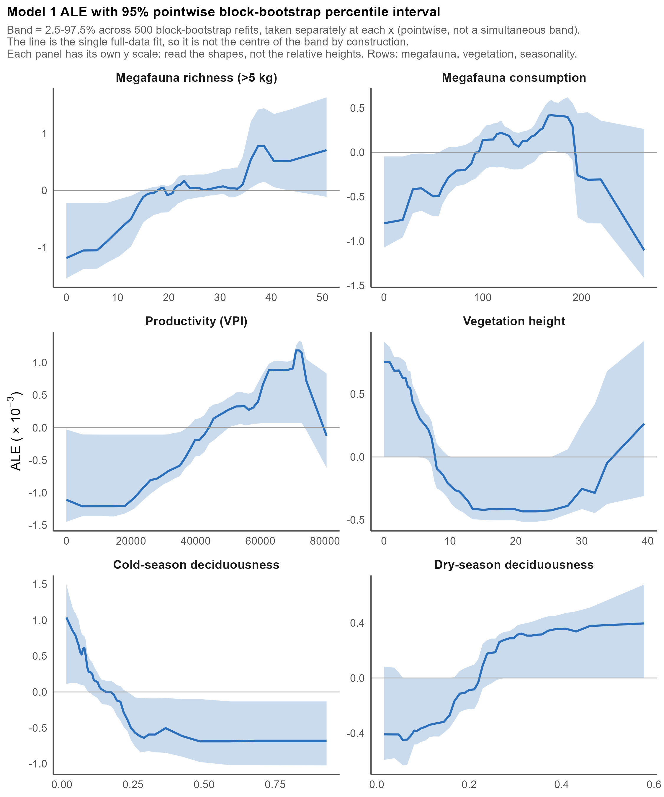
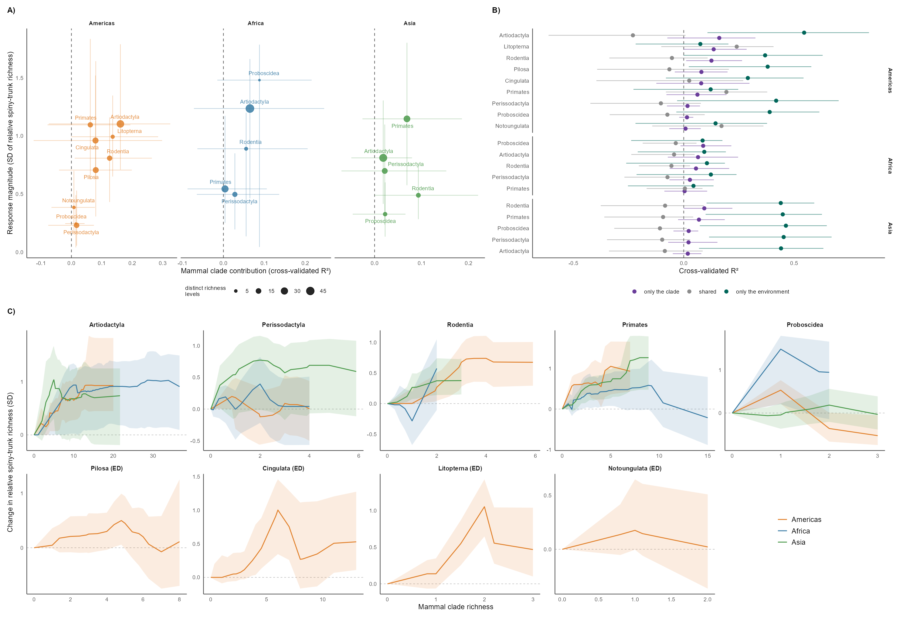

# Global ecology and evolutionary drivers of spiny-trunk trees — reproducibility archive (R)

A single all-R pipeline for the study of the global distribution, ecological associations and
megafaunal-herbivory drivers of woody plants bearing spines on their **trunks**. It compiles
the species dataset, builds global richness layers, and analyses them with gradient-boosted
regression trees (**CatBoost**) under spatial cross-validation.

Everything — data preparation, models and figures — runs in R.


**74 mapped species · 1° analysis grid · spatial cross-validation · R / CatBoost**

[Main figures](#main-figures) · [Pipeline](#pipeline-r) · [Reproducing](#reproducing) ·
[Output index](outputs/README.md) · [Environment](ENVIRONMENT.md) · [Repository review](REVIEW.md)

## Main figures

The figures below are the committed analysis outputs. Click an image to inspect the
full-size figure. Separate prickly and thorny results are linked in the
[output index](outputs/README.md).

### Global distribution, biomes and ecoregions

[](outputs/descriptive/FIG_composite_total.png)

**Total condition (74 mapped species).** The map shows relative richness at 1°.
Biome distributions and ecoregion summaries describe its geographic pattern;
ecoregion intervals use spatial block bootstrapping. Open points have no reportable
interval because fewer than three effective blocks are available.
[Source summaries](outputs/descriptive/) · [Script](R/02_descriptive.R)

### Environmental associations — Model 1

[](outputs/model1/M1_ALE.png)

Accumulated local effects (ALE) describe fitted response shapes among occupied cells.
Shading is a 95% **pointwise** block-bootstrap percentile interval; the line is the
full-data fit. These curves are not a predictor-importance ranking or a causal test.
Pooled out-of-fold R² is **0.372** (SD **0.019** across 10 spatial fold allocations).
[Performance table](outputs/model1/performance_summary.csv) ·
[ALE values](outputs/model1/ale_curves.csv) · [Script](R/05_model1.R)

### Mammal-clade associations — Model 2

[](outputs/model2/FIG_M2_composite.png)

**Total condition.** The panels bring together response magnitude, the cross-validated
R² partition, and unconstrained response shapes across the Americas, Africa and Asia.
Across all three conditions, 56 of 90 screened combinations are estimable; only
**3 of 56** clade-increment intervals exclude zero. Positive constrained response
magnitudes alone are not evidence of an association.
[Coverage](outputs/model2/TAB_M2_coverage.csv) ·
[Clade and environment results](outputs/model2/model2_env_results.csv) ·
[Script](R/06_model2.R)

> **Interpretation:** models describe variation in relative richness where spiny-trunk
> species occur. Spatial dependence, correlated predictors and uncertainty remain
> important; see [method notes](#method-notes) and the diagnostic figures in the
> [output index](outputs/README.md).


---

## Pipeline (`R/`)

The descriptive step precedes the modelling: the models and the mammal-ecoregion step build
on the richness layers and the ecoregion ranking it produces.

| step | script | does | writes to |
|---|---|---|---|
| 0 | `00_standardization.R` | standardise species names against WFO and WCVP, synonyms resolved with **TNRS** (needs internet). Documentation only — the spatial pipeline matches range files by filename and does not read its output | `data/processed/` |
| 1 | `01_biogeography.R` | rasterise species ranges, divide by vascular plant richness → absolute and relative richness (total / prickly / thorny) | `outputs/biogeography/` |
| 2 | `02_descriptive.R` | richness maps, biome distributions, ecoregion means with block-bootstrap intervals, the Figure 3 composite | `outputs/descriptive/` |
| 3 | `03_mammal_ecoregions.R` | present-natural megafauna (>5 kg) of the richest ecoregion per continent, plus the richest one with a reportable interval where the leader has none | `outputs/ecoregion_mammal/` |
| 4 | `04_data_preparation.R` | model-ready predictor stack and per-clade richness stack | `outputs/raster_model/` |
| 5 | `05_model1.R` | **Model 1** — environmental characterisation via **ALE**, plus design checks (resolution, transform, ratio) and species-drop robustness; sections selectable with `M1_RUN` | `outputs/model1/` |
| 6 | `06_model2.R` | **Model 2** — mammal-clade associations, each clade fitted **alone and with** four environmental covariates, and **unconstrained and monotone-constrained**: response magnitude, the cross-validated R² partition with bootstrap intervals, response shapes, and a species-drop check | `outputs/model2/` |

`05_model1.R` has sections 0–10, plus a ratio-check subsection: inputs and collinearity, block size, tuning, block
re-check, performance, residual diagnostics, the block-bootstrap ALE ensemble, resolution,
transform, ratio check, species-drop, figures.

`06_model2.R` runs in seven: settings, appearance, helpers, inputs, models, robustness,
figures and tables. **Section 7 reads back the CSVs sections 5–6 write**, so figures can be
redrawn without refitting anything.

`R/config.R` holds `here()`-based paths, `R/requirements.R` lists packages, and
`ENVIRONMENT.md` records the verified versions — read its `terra` note before changing
`04_data_preparation.R`.

## The three conditions

Every descriptive and Model 2 analysis runs for **total** (all 74 mapped species), **prickly**
(46, phellogen-derived) and **thorny** (28, bud-derived). The response is **relative richness**
= spiny-trunk species ÷ vascular plant richness, which partly controls for uneven background
plant diversity.

## Method notes

- **1° analysis unit**, aggregated from 0.1°, keeping a 1° cell only where at least 10 of its
  100 source cells carry data. The reason is pseudo-replication: 74 species ranges cannot
  support ~398k cells. The resolution sweep is a check rather than the justification — it
  rules out 0.1° firmly and cannot separate 1° from 2°.

- **The response is conditioned on presence.** `01_biogeography.R` sets cells with no
  spiny-trunk species to `NA`, so both models describe variation *among occupied cells*. They
  do not model presence/absence, and absences are not zeros.

- **Spatial resampling throughout**, never cell-level — neighbouring cells are strongly
  autocorrelated. Block sizes come from the range at which residual spatial correlation falls
  below 0.1, converted at 111.32·cos(|lat| p90) and rounded up. Model 1 measures this globally
  and gets 8°. Model 2 fits continental subsets, so it measures within each continent and gets
  12° / 7° / 8° for the Americas, Africa and Asia. The descriptive summaries use 2°, from the
  much shorter within-ecoregion range.

- **Model 1 characterises where richness is high**, through ALE response shapes, and does not
  rank predictor importance. All six predictors are entangled — cross-validated nonlinear
  predictability spans 0.67–0.85 — so the two megafauna metrics are read as one axis and the
  redundancy is disclosed rather than resolved. Concurvity is measured under random 3-fold CV,
  not spatial blocks, so read it as a ranking of entanglement rather than calibrated R².

- **The ALE band is pointwise, and the curve is not its centre.** It is a 2.5–97.5 percentile
  interval taken separately at each evaluation point across 500 block-bootstrap refits, not a
  simultaneous band. The plotted line is the single full-data fit, so it sits off-centre by
  construction.

- **Tuning does not discriminate.** All 12 grid configurations fall within one standard error
  of the minimum, so the 1-SE rule returns the most regularised corner of the grid by
  construction rather than by selection. Hyperparameters are chosen on the same cells that
  produce the reported R², so the estimate is post-selection; with a grid this flat the effect
  is small.

- **Model 2 fits each clade separately**; these fits do not isolate independent effects
  among correlated clades. It fits every clade twice — alone, and with the four environmental covariates. Its learner
  is fixed a priori (depth 4, L2 10, 300 iterations, no subsampling) so that scores stay
  comparable across clades rather than reflecting differences in tuned capacity.

- **The explained variance is partitioned within each fold assignment** into the part only the
  clade supplies, the part only the environment supplies, and the part either could supply.
  The three sum to R²(clade + environment) exactly. A **negative shared component is not an
  error**: it means the two are complementary, predicting more together than their separate
  skills imply.

- **Response magnitude is a descriptive effect size, not a test.** The monotone constraint
  makes it non-negative by construction, so its interval clears zero in 56 of 56 combinations
  — a property of the constraint, not evidence. **Inference rests on the R² increment over an
  environment-only model.** Direction is read from the unconstrained curves, which are free to
  fall.

- **Ten clades are screened, nine are reported.** Diprotodontia survives the Australasian
  realm exclusion in one or two coastal cells per condition and is then dropped by the
  estimability rule (at least three distinct richness values), which is why a run prints three
  `skip … Diprotodontia` messages. `TAB_M2_coverage.csv` records every screened combination.

- **One definition of megafauna richness across both models.** Each clade layer is the sum of
  its species ranges in the source CRS, reprojected once by nearest neighbour — these are
  counts of 0/1 presences and PHYLACINE is coarser than the 0.1° template, so bilinear would
  turn a count into a fraction. Model 1's `mammal_richness` is the sum of those clade layers,
  so the two models cannot drift apart (`04_data_preparation.R`).

- **The genus *Homo* is excluded** from the large-herbivore pool alongside Carnivora,
  Dasyuromorphia and Afrosoricida (`EXCLUDE_GENERA` in `config.R`). Humans are the agent of
  the extinctions being measured rather than a source of the herbivory pressure being tested.
  The exclusion is at genus level so that gorillas and chimpanzees, which do feed on bark,
  remain in the pool.

- **Residual short-range spatial autocorrelation persists** in both models and is disclosed as
  a limitation. It is handled by resampling whole spatial blocks, not by adding a coordinate
  term.

## Reproducing

1. **Install R packages** — `source("R/requirements.R")`.
2. **Install CatBoost for R** (not on CRAN) from the official release binary, e.g.
   `install.packages("https://github.com/catboost/catboost/releases/download/v1.2.10/catboost-R-windows-x86_64-1.2.10.tgz", repos=NULL)`
   — pick the file for your OS. This archive was built and verified with **CatBoost 1.2.10**.
3. **Get the heavy data** from Dryad (DOI in `data/README.md`): raw species and PHYLACINE
   mammal ranges, environmental rasters, the Ecoregions2017 shapefile, and the derived
   richness and predictor stacks. These are not in git, by size.
4. **Run** `run_pipeline.R`, or the `R/` scripts in order. Steps are not independent: 03 reads
   the ecoregion ranking 02 writes, and 05/06 read the stacks 04 writes.

Run from the repository root so `here()` resolves. For example, in an R session:

```r
source("R/requirements.R")
# Install the matching CatBoost binary as described above, then provision the data.
source("run_pipeline.R")
```

**To reproduce the recorded numbers:** use the archived predictor and clade stacks,
the required richness layers and species ranges, and the versions in
[ENVIRONMENT.md](ENVIRONMENT.md). Run the modelling scripts directly:

```r
source("R/05_model1.R")
source("R/06_model2.R")
```

Running the full pipeline rebuilds the stacks. Step 4 has a documented `terra`
NA-boundary instability, so a rebuild can change the analysis cells and numerical
results. Preserve a separate copy of the archived stacks before rebuilding.
Model 1 defaults to all sensitivity analyses; reduced `M1_RUN` selections are
development runs and do not regenerate the complete result set.

Step 0 needs internet access for TNRS and is not read by the spatial analyses;
for an offline analysis, run scripts 01–06 in order after provisioning their inputs.
 Country
borders for the maps are in `data/assets/world_borders.geojson`. Committed outputs are figures
(`.png`) and summary tables (`.csv`); rasters and the per-cell `predictor_table.csv` are
regenerated by 01 and 04 or taken from Dryad.

## Headline numbers

Recorded so the manuscript and the archive cannot drift apart.

| quantity | value | source |
|---|---|---|
| Model 1 pooled out-of-fold R² | **0.372** (SD 0.019 over 10 fold allocations, range 0.338–0.395) | [model1/performance_summary.csv](outputs/model1/performance_summary.csv) |
| — training R² / overfit gap | 0.565 / 0.193 | same |
| — RMSE | 0.00148 | same |
| — mean of per-fold R² (weaker statistic) | 0.324 (SD 0.155); fold 2.5–97.5% −0.084 to 0.561 | same |
| Model 1 calibration slope | 0.999 (SD 0.086 over 10 allocations, range 0.898–1.173) | [model1/calibration.csv](outputs/model1/calibration.csv) |
| Analysis unit | 1° → 4,806 cells, from 398,474 at 0.1° | [model1/resolution_sweep.csv](outputs/model1/resolution_sweep.csv) |
| Resolution sweep | 0.294 (0.1°) · 0.323 (0.5°) · 0.366 (1°) · 0.370 (2°) | same |
| Model 1 block size | **8°**, from a 675 km residual range; re-deriving with the tuned hyperparameters gives the same | [model1/blocksize_recheck.csv](outputs/model1/blocksize_recheck.csv) |
| Residual Moran's I at 75 km | 0.743 (SD 0.029 over 10 allocations × 5 subsamples); below 0.1 from the 825 km bin | [model1/residual_correlogram.csv](outputs/model1/residual_correlogram.csv) |
| Predictor entanglement | concurvity 0.67–0.85; maximum VIF 4.83 | [model1/predictor_concurvity.csv](outputs/model1/predictor_concurvity.csv) |
| Model 1 tuning | 12 configurations, all within 1 SE; 1-SE pick depth 3, L2 30 | [model1/tuning_grid.csv](outputs/model1/tuning_grid.csv) |
| Model 1 species-drop (30% removed) | 0.350 ± 0.081 over 300 replicates, against 0.392 for the full pool (52 of 74 species kept) | [model1/jackknife.csv](outputs/model1/jackknife.csv) |
| Model 2 cells per continent | Americas 2,062 · Africa 1,414 · Asia 1,129 | [model2/TAB_S_model2_strata.csv](outputs/model2/TAB_S_model2_strata.csv) |
| Model 2 block sizes | 12° / 7° / 8° from 975 / 675 / 675 km; 34 / 46 / 48 blocks | [model2/TAB_S_model2_autocorrelation.csv](outputs/model2/TAB_S_model2_autocorrelation.csv) |
| Model 2 settings | depth 4, L2 10, 300 iterations, no subsampling; 5 folds × 10 allocations; 250 block-bootstrap resamples | [model2/TAB_S_model2_settings.csv](outputs/model2/TAB_S_model2_settings.csv) |
| Model 2 coverage | 56 of 90 clade × continent × condition combinations estimable | [model2/TAB_M2_coverage.csv](outputs/model2/TAB_M2_coverage.csv) |
| Model 2 contributions excluding zero | 3 of 56; shared component negative in 44 of 56 | [model2/model2_env_results.csv](outputs/model2/model2_env_results.csv) |
| Model 2 species-drop | 30% of species removed, 90 replicates, total condition only | [model2/TAB_M2_jackknife.csv](outputs/model2/TAB_M2_jackknife.csv) |
| Descriptive block bootstrap | 2°, from a 175 km within-ecoregion range; 2,000 resamples per ecoregion | [descriptive/within_ecoregion_correlogram_summary.csv](outputs/descriptive/within_ecoregion_correlogram_summary.csv) |
| Ecoregions keeping an interval | 302 of 462; the rest hold fewer than 3 effective 2° blocks | [descriptive/ecoregion_summary_total.csv](outputs/descriptive/ecoregion_summary_total.csv) |
| Richest ecoregion per continent | Beni savanna (4.9 effective blocks) · Cross-Niger transition forests (1.4, **no interval** — Sudd flooded grasslands, 6.1, reported alongside) · Tonle Sap freshwater swamp forests (3.7) | [ecoregion_mammal/ecoregion_mammals.csv](outputs/ecoregion_mammal/ecoregion_mammals.csv) |
| — megafauna species in each | Beni 40 · Cross-Niger 16 · Sudd 33 · Tonle Sap 18 | same |

Prefer **pooled out-of-fold R²** to the mean of per-fold R². Per-fold R² divides by each
fold's own variance, so a fold covering a homogeneous region scores badly even when its RMSE
is low. The fold spread is largely a denominator artefact rather than regional model failure.

## Citation and licence

The associated article has been **accepted in Global Ecology and Biogeography**.
The author has confirmed **Creative Commons Attribution–NonCommercial–NoDerivatives
4.0 International (CC BY-NC-ND 4.0)** as the article's publication licence.
The full bibliographic citation and article DOI will be added when available.

Licensing is specific to the material:

- **Source code and software documentation:** the existing [MIT Licence](LICENSE)
  applies to the R scripts and their software documentation.
- **Article and article figures:** consult the article's
  [CC BY-NC-ND 4.0 licence](https://creativecommons.org/licenses/by-nc-nd/4.0/)
  and any figure-specific credit lines. That licence permits sharing with attribution
  for non-commercial purposes; it does not permit distributing adapted material.
  The software's MIT licence does not replace the article's publication terms.
- **Data and other outputs:** see the [data guide](data/README.md), the Dryad
  deposit's licence and the terms of the original data providers. The article
  licence is not automatically a licence for every dataset or generated output
  in this repository.

Please cite the article and the relevant data archive when using this work.
